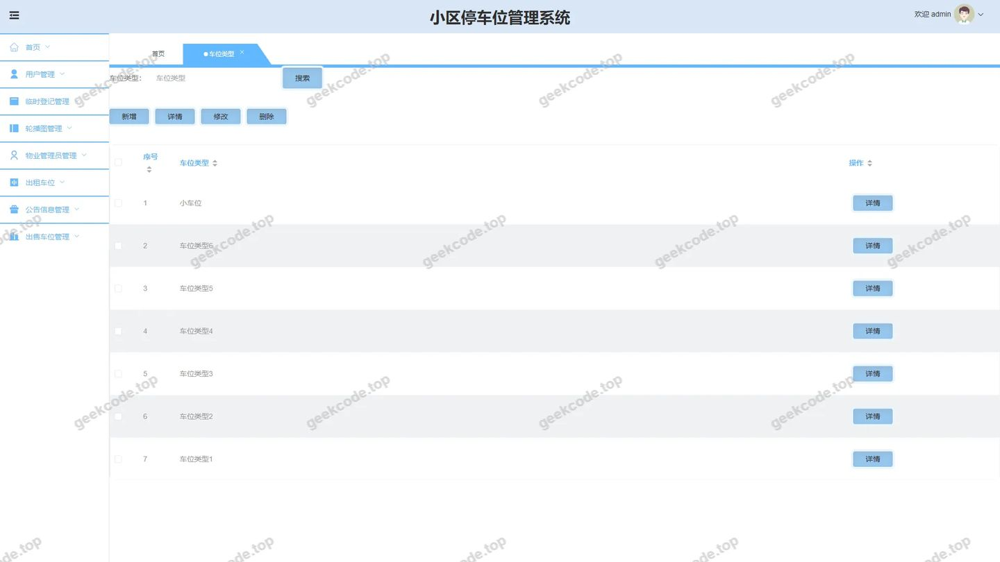
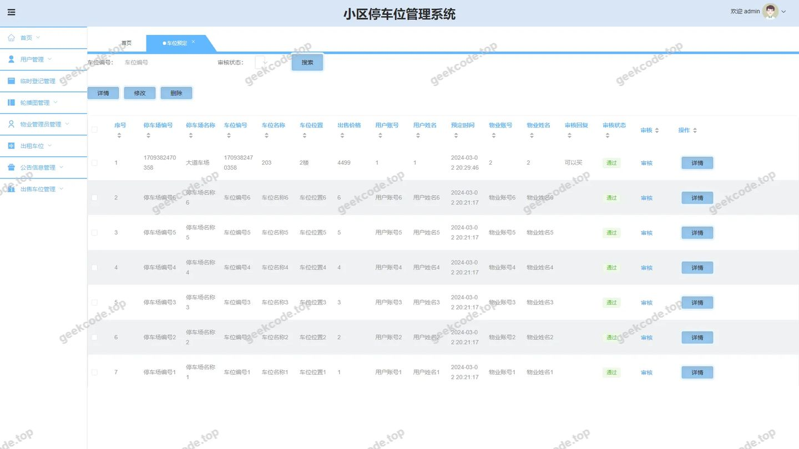
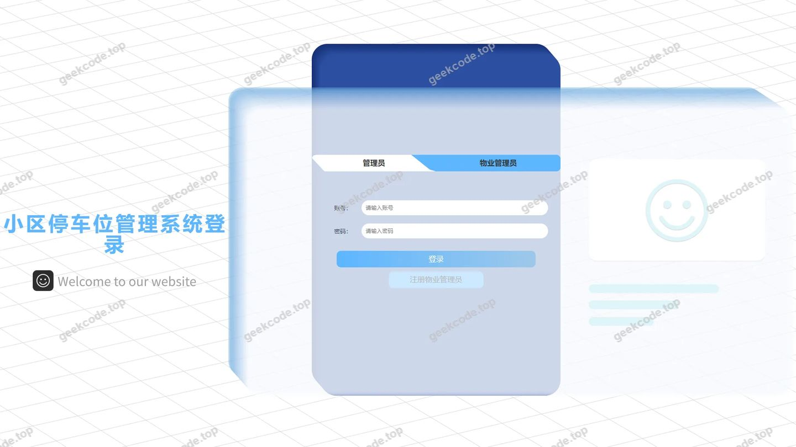
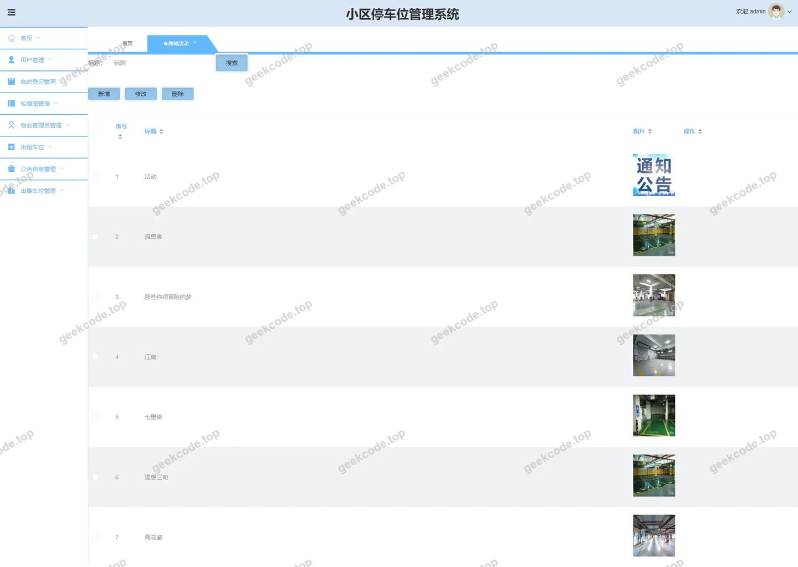
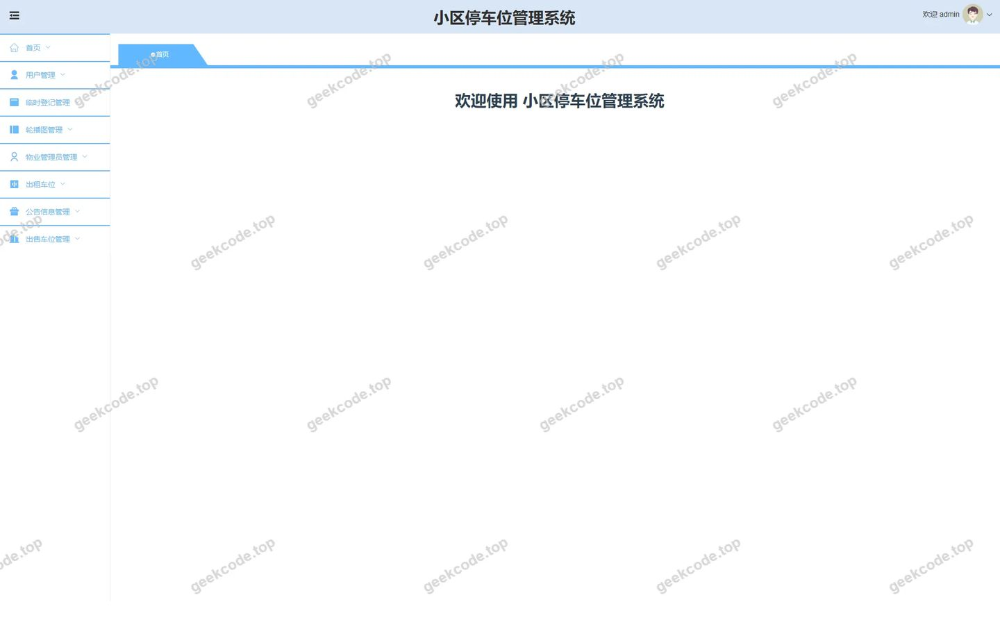
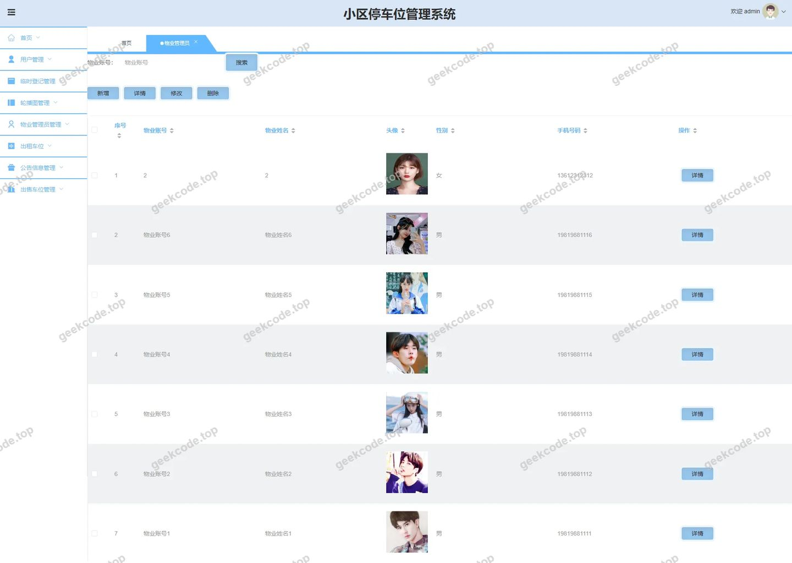
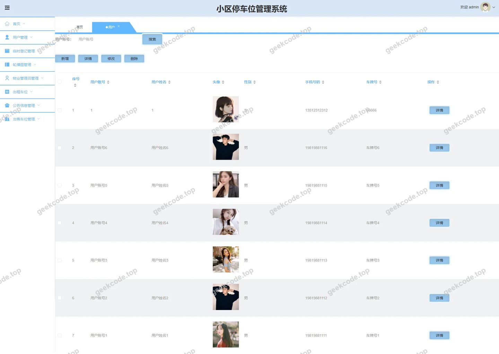
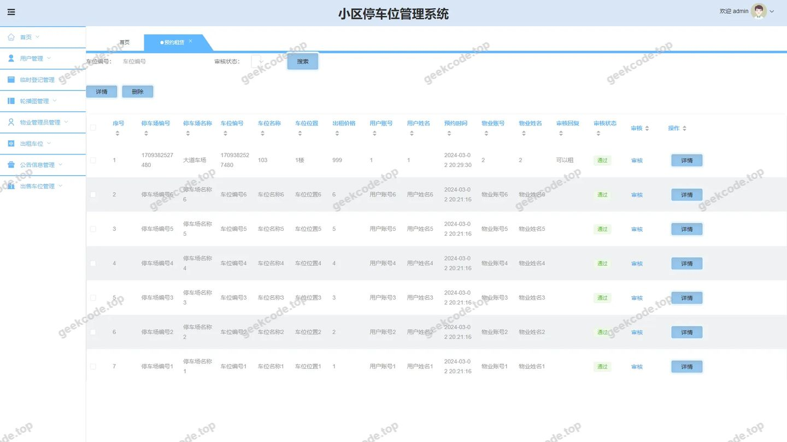

# java小区停车位管理系统

> 🎓 **计算机毕业设计 · java小区停车位管理系统**
>
> 本仓库只放**项目介绍 + 运行截图**（截图是站点带水印的原图，存在仓库 `images/` 里）。
>
> 👉 **完整可运行源码 / 数据库脚本 / 部署文档：[点我获取](https://geekcode.top/archives/java%E5%B0%8F%E5%8C%BA%E5%81%9C%E8%BD%A6%E4%BD%8D%E7%AE%A1%E7%90%86%E7%B3%BB%E7%BB%9F?utm_source=github)**
>
> 💬 咨询微信：**ir9372**　|　🌐 更多项目：[极客代码 geekcode.top](https://geekcode.top/?utm_source=github)
>
> 📌 项目详情页：<https://geekcode.top/archives/java%E5%B0%8F%E5%8C%BA%E5%81%9C%E8%BD%A6%E4%BD%8D%E7%AE%A1%E7%90%86%E7%B3%BB%E7%BB%9F?utm_source=github>

<table><td width="230" align="center"> <b>扫码加微信 ir9372</b></td><td valign="middle">📦 源码 = 项目介绍 + 全部运行截图 + 数据库 + 部署文档 👉 点上方任意截图，直接跳到 <b>极客代码 geekcode.top</b> 详情页</td></table>

---

<h1>java小区停车位管理系统</h1>
<h2>项目概述</h2>

本项目旨在构建一个基于 Web 的小区停车位管理系统，解决传统小区停车管理中信息不透明、预约流程繁琐及车位资源分配不均等问题。系统采用前后端分离架构，核心功能涵盖车位类型管理、车位租赁与购买交易、临时登记、预约租赁及用户信息管理。适用人群主要为小区业主（普通用户）和物业管理员。通过数字化手段，实现车位资源的在线查询、预定、交易及后台统一监管，提升物业管理效率与用户体验。技术架构上，后端基于 Spring Boot 框架结合 MyBatis-Plus 进行数据持久化操作，使用 Shiro 进行权限控制；前端采用 Vue 框架构建交互界面，确保系统的高可用性与扩展性。

<h2>技术架构</h2>
<h3>1. 前后端架构</h3>

系统采用典型的 B/S 架构模式，分为前台用户端和后台管理端。

<ul>
<li><strong>后端服务</strong>：基于 Java 语言开发，核心框架为 Spring Boot。利用 <code>spring-boot-starter-web</code> 提供 RESTful API 接口支持，集成 <code>mybatis-spring-boot-starter</code> 和 <code>mybatis-plus</code> 作为 ORM 框架，简化数据库 CRUD 操作并提高开发效率。安全层面引入 <code>shiro-spring</code> 进行身份认证与授权管理，确保接口访问的安全性。</li>
<li><strong>前端展示</strong>：采用 Vue.js 框架实现组件化开发，通过路由管理页面跳转。前端通过 Axios 等工具调用后端 API 获取数据并渲染视图，实现动态交互。</li>
</ul>
<h3>2. 数据库设计要点</h3>

数据库选用 MySQL，主要实体包括用户、物业管理员、车位类型、车位租赁记录、车位购买记录、预约租赁记录、临时登记信息等。表结构设计遵循第三范式，通过外键关联各业务模块，确保数据的一致性与完整性。例如，车位预定表需关联用户ID和车位类型ID，以追踪具体的租赁或购买行为。

<h3>3. 核心技术选型理由</h3>
<ul>
<li><strong>Spring Boot</strong>：约定优于配置，快速搭建微服务基础，内置 Tomcat 容器便于部署。</li>
<li><strong>MyBatis-Plus</strong>：在 MyBatis 基础上增强，提供通用 CRUD 方法，减少样板代码，适合中小型业务系统的快速迭代。</li>
<li><strong>Shiro</strong>：轻量级且功能强大的安全框架，相比 Spring Security 更易于上手，适合本项目的权限粒度需求。</li>
<li><strong>Vue</strong>：响应式数据绑定和组件化思想，提升了前端页面的维护性和用户体验。</li>
</ul>
<h2>功能模块</h2>

根据路由配置及截图信息，系统功能划分为前台用户端和后台管理端两大板块。

<h3>1. 前台用户端</h3>

前台主要面向小区居民及潜在购车位用户，提供信息查询与业务办理入口。

<ul>
<li><strong>首页与信息浏览</strong>：展示新闻公告（<code>/index/newsList</code>）、车位类型列表（<code>/index/cheweileixingList</code>）及详情。</li>
<li><strong>用户中心</strong>：包含用户注册（<code>/index/yonghuAdd</code>）、个人信息查看与维护（<code>/index/yonghuCenter</code>, <code>/index/yonghuDetail</code>）。</li>
<li><strong>车位交易与管理</strong>：</li>
<li><strong>车位租赁</strong>：查看可租车位列表（<code>/index/cheweizulinList</code>），提交租赁申请（<code>/index/cheweizulinAdd</code>）。</li>
<li><strong>车位购买</strong>：查看出售车位列表（<code>/index/cheweigoumaiList</code>），发起购买意向（<code>/index/cheweigoumaiAdd</code>）。</li>
<li><strong>车位预定</strong>：对特定车位进行预定操作（<code>/index/cheweiyudingList</code>, <code>/index/cheweiyudingAdd</code>）。</li>
<li><strong>预约租赁</strong>：针对特定时段的租赁预约（<code>/index/yuyuezulinList</code>, <code>/index/yuyuezulinAdd</code>）。</li>
<li><strong>临时登记</strong>：访客或临时车辆的信息登记（<code>/index/linshidengjiList</code>）。</li>
<li><strong>出租车位</strong>：个人车主发布闲置车位出租信息（<code>/index/chuzucheweiList</code>, <code>/index/chuzucheweiAdd</code>）。</li>
</ul>
<h3>2. 后台管理端</h3>

后台主要面向物业管理员，用于全局资源调度、审核及系统配置。

<ul>
<li><strong>登录与仪表盘</strong>：管理员登录页及后台首页概览。</li>
<li><strong>人员管理</strong>：</li>
<li><strong>用户管理</strong>：查看、编辑或删除注册用户信息（<code>/yonghu</code>）。</li>
<li><strong>物业管理员管理</strong>：管理员账号的增删改查及注册审核（<code>/wuyeguanliyuan</code>, <code>/wuyeguanliyuanRegister</code>）。</li>
<li><strong>业务管理</strong>：</li>
<li><strong>车位类型管理</strong>：定义和维护车位的分类属性（如地上/地下、标准/豪华等）（<code>/cheweileixing</code>）。</li>
<li><strong>租赁与交易审核</strong>：处理用户的租赁申请、购买订单及预定请求（<code>/yuyuezulin</code>, <code>/cheweiyuding</code>, <code>/cheweizulin</code>, <code>/cheweigoumai</code>）。</li>
<li><strong>出租车位管理</strong>：审核个人发布的出租车位信息（<code>/chuzuchewei</code>）。</li>
<li><strong>临时登记管理</strong>：查看和管理临时车辆的登记记录（<code>/linshidengji</code>）。</li>
<li><strong>初收车位管理</strong>：处理车位的首次入库或初始状态设置（<code>/chushouchewei</code>）。</li>
<li><strong>系统配置</strong>：修改系统参数及新闻内容管理（<code>/config</code>, <code>/news</code>）。</li>
</ul>
<h2>用户角色与权限</h2>

系统主要包含两种角色：<strong>普通用户</strong>和<strong>物业管理员</strong>。

<table>
<thead>
<tr>
<th align="left">角色</th>
<th align="left">权限描述</th>
<th align="left">可访问功能模块</th>
</tr>
</thead>
<tbody><tr>
<td align="left"><strong>普通用户</strong></td>
<td align="left">拥有基本的浏览、注册、登录及业务申请权限。无法进入后台管理系统。</td>
<td align="left"><strong>前台路由</strong>：1. 首页/新闻列表2. 用户注册/个人中心/信息修改3. 车位类型浏览4. 车位租赁/购买/预定的申请与查看5. 预约租赁的申请与查看6. 临时登记的提交7. 出租车位信息的发布与查看</td>
</tr>
<tr>
<td align="left"><strong>物业管理员</strong></td>
<td align="left">拥有最高权限，可对系统内所有数据进行管理、审核和配置。</td>
<td align="left"><strong>后台路由</strong>：1. 后台登录2. 用户管理（查看/删除）3. 物业管理员管理（注册审核/权限分配）4. 车位类型管理（增删改查）5. 预约租赁管理（审核/状态变更）6. 车位预定管理7. 临时登记管理8. 出租车位管理9. 车位租赁管理10. 车位购买管理11. 初收车位管理12. 系统配置与新闻管理</td>
</tr>
</tbody></table>
<h2>项目特色与创新点</h2>
<ol>
<li><strong>全流程数字化管理</strong>：覆盖了从车位信息发布、用户浏览、在线申请到后台审核的全生命周期，消除了纸质记录和人工沟通的低效环节。</li>
<li><strong>多维度的车位交易模式</strong>：系统不仅支持传统的长期租赁和购买，还引入了“预约租赁”、“临时登记”和“个人出租车位”等多种灵活的交易场景，适应了现代小区多样化的停车需求。</li>
<li><strong>基于 Shiro 的安全管控</strong>：实现了细粒度的权限控制，确保只有授权的物业管理员才能执行关键的数据修改和审核操作，保障了用户隐私和数据安全。</li>
<li><strong>前后端分离的高效体验</strong>：采用 Vue + Spring Boot 架构，使得界面响应速度快，用户体验流畅，同时后端逻辑清晰，便于后续的维护和功能扩展。</li>
</ol>
<h2>部署环境</h2>

为确保项目正常运行，需准备以下软件环境：

<ol>
<li><strong>Java 运行环境</strong>：JDK 1.8 或更高版本。</li>
<li><strong>数据库</strong>：MySQL 5.7 或 MySQL 8.0+，需安装相应的 JDBC 驱动（mysql-connector-java）。</li>
<li><strong>Web 服务器</strong>：内置 Tomcat（由 Spring Boot 自动集成），无需单独安装外部 Tomcat。</li>
<li><strong>前端运行环境</strong>：Node.js (建议 LTS 版本) 和 npm/yarn，用于编译和打包 Vue 前端代码。</li>
<li><strong>构建工具</strong>：Maven 3.6+，用于管理后端依赖和项目构建。</li>
<li><strong>浏览器</strong>：Chrome, Firefox, Edge 等主流现代浏览器。</li>
</ol>
<h2>五、技术特性</h2>
<ul>
<li>前后端集成部署，前端资源打包至后端 static 目录</li>
<li>使用 MyBatis-Plus 简化数据访问层开发</li>
<li>集成 Shiro 权限框架实现角色权限控制</li>
</ul>
<h2>六、功能模块截图</h2>
<h3>前台用户端</h3>
<h4>前台-首页</h4>

<h4>前台-登录</h4>

<h4>前台-用户注册</h4>

<h3>后台管理端</h3>
<h4>后台-车位类型</h4>

<h4>后台-车位预定</h4>

<h4>后台-登录页</h4>

<h4>后台-商城活动</h4>

<h4>页面-首页</h4>

<h4>后台-物业管理员</h4>

<h4>后台-用户</h4>

<h4>后台-预约租赁</h4>

---

## 获取完整源码

| 项目 | 说明 |
| --- | --- |
| 项目名 | java小区停车位管理系统 |
| 运行截图 | 本文 11 张（站点带水印原图，仓库 `images/` 目录） |
| 完整源码 | [https://geekcode.top/archives/java%E5%B0%8F%E5%8C%BA%E5%81%9C%E8%BD%A6%E4%BD%8D%E7%AE%A1%E7%90%86%E7%B3%BB%E7%BB%9F?utm_source=github](https://geekcode.top/archives/java%E5%B0%8F%E5%8C%BA%E5%81%9C%E8%BD%A6%E4%BD%8D%E7%AE%A1%E7%90%86%E7%B3%BB%E7%BB%9F?utm_source=github) |
| 咨询微信 | **ir9372**（备注：jingpin-yuanma） |
| 更多项目 | [极客代码 geekcode.top](https://geekcode.top/?utm_source=github) |

> 需要源码、部署、改配置、跑不起来等问题，加微信 ir9372 沟通，说明项目名即可。
